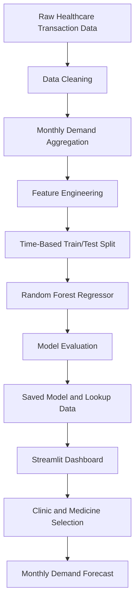

 <div align="center">

# 💊 AI-Powered Medicine Demand Forecasting

### Predicting monthly medicine requirements for partner healthcare clinics using Machine Learning.

<p>
  
  
  
  
</p>

**Transforming historical healthcare transaction data into data-driven inventory forecasts.**

[Overview](#-overview) • [Features](#-key-features) • [Workflow](#-project-workflow) • [Installation](#-installation) • [Usage](#-using-the-dashboard)

</div>

---

## 📌 Overview

Healthcare clinics must estimate monthly medicine requirements accurately. Poor estimates can lead to overstocking, expired medicines, unnecessary costs, and critical stockouts.

This project builds a machine learning forecasting pipeline that analyzes historical partner healthcare transactions and predicts monthly medicine demand for individual clinics and medicine bundles.

### 🎯 Project Objectives

- Forecast monthly medicine quantities using historical demand.
- Identify consumption patterns across clinics and medicine bundles.
- Engineer time-based features to capture demand trends and seasonality.
- Support inventory planning and procurement decisions.

---

## ✨ Key Features

<details>
<summary><b>📊 Large-Scale Data Processing</b></summary>

- Load and inspect historical healthcare transaction records.
- Clean inconsistent strings, dates, and missing values.
- Aggregate records by clinic, medicine bundle, and month.

</details>

<details>
<summary><b>⚙️ Machine Learning Pipeline</b></summary>

- Engineer lag-based demand features.
- Extract calendar month information.
- Use a time-based 80/20 training and testing split.
- Train a Random Forest Regressor to predict continuous demand quantities.

</details>

<details>
<summary><b>📈 Interactive Forecasting Dashboard</b></summary>

- Select a clinic from a dropdown.
- Choose an associated medicine bundle.
- Select a forecast horizon.
- Generate a predicted medicine quantity using the trained model.

</details>

---

## 🛠️ Tech Stack

| Technology | Purpose |
|---|---|
| Python | Core programming language |
| Pandas & NumPy | Data cleaning, aggregation, and feature engineering |
| Scikit-learn | Random Forest regression model |
| Streamlit | Interactive web dashboard |
| Google Colab | Notebook-based development |
| Pickle | Serialization of the trained model and lookup data |

---

## 🔄 Project Workflow



---

## 🧠 Methodology

### 1. Data Extraction and Cleaning

- Processed approximately 4.8 million raw healthcare log records.
- Standardized date formats and string values.
- Converted string representations of `NULL` into proper missing values.

### 2. Monthly Demand Aggregation

Grouped transaction records by:

- Clinic
- Medicine bundle
- Month

The resulting aggregated dataset contained approximately 2.2 million rows.

### 3. Feature Engineering

| Feature | Description |
|---|---|
| `lag_1` | Demand from the previous month |
| `lag_2` | Demand from two months earlier |
| Calendar month | Captures month-specific demand patterns |

### 4. Model Training

- Model: `RandomForestRegressor`
- Validation approach: time-based 80/20 split
- Target: monthly medicine demand quantity

### 5. Model Evaluation

| Metric | Reported result |
|---|---:|
| Mean Absolute Error (MAE) | 1.92 units |

The reported MAE represents the average absolute difference between the predicted and actual quantities, subject to the evaluation dataset and target definition.

---

## 📂 Project Structure

```text
Medicine-Demand-Forecasting/
│
├── app.py
├── Medicine_Demand_Forecasting.ipynb
├── medicine_demand_model.pkl
├── monthly_demand_lookup.pkl
└── README.md
```

---

## 🚀 Installation

### Prerequisites

- Python 3.10 or a compatible version
- Git
- pip

### 1. Clone the Repository

```bash
git clone https://github.com/rucha-code-nodes/Medicine-Demand-Forecasting.git
cd Medicine-Demand-Forecasting
```

### 2. Install Dependencies

```bash
pip install streamlit pandas scikit-learn numpy
```

If your application imports additional libraries, install those as well.

### 3. Run the Application

```bash
streamlit run app.py
```

Open the local URL printed in your terminal, typically:

`http://localhost:8501`

---

## 🖥️ Using the Dashboard

1. **Select a clinic** from the available clinic list.
2. **Choose a medicine bundle** associated with that clinic.
3. **Select the forecast horizon** using the available month selector.
4. **Generate the forecast** to view the predicted medicine quantity.

The prediction depends on the features, historical lookup data, and model logic implemented in `app.py`.

---

## 📓 Project Notebook

The Jupyter notebook contains the data preparation, exploratory analysis, feature engineering, and model development workflow.

Open `Medicine_Demand_Forecasting.ipynb` in GitHub to review the saved notebook, or open it in Google Colab to execute it.

---

## 🔮 Potential Future Improvements

- Compare Random Forest with gradient boosting and time-series models.
- Evaluate performance across individual clinics and medicine bundles.
- Add prediction intervals and low-stock alerts.
- Deploy the dashboard with controlled access.
- Monitor forecast errors as new transaction data becomes available.

---

<div align="center">

### 💡 Data-Driven Forecasting for Better Healthcare Inventory Planning

*Built with Python, Machine Learning, and Streamlit.*

[⬆ Back to Top](#-ai-powered-medicine-demand-forecasting)

</div>
